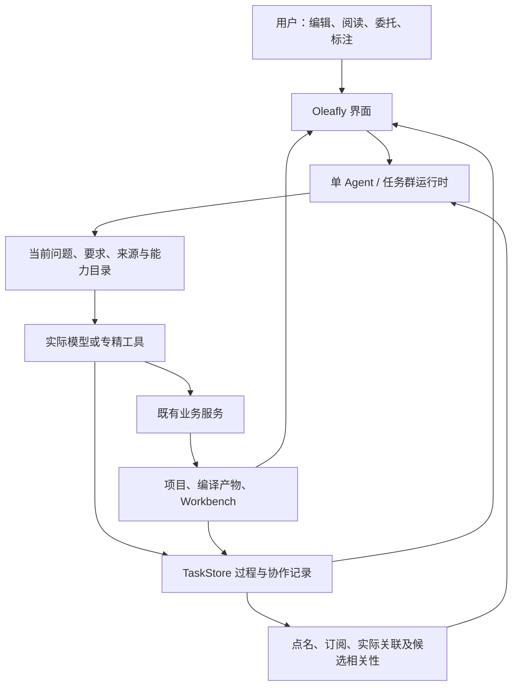

# Oleafly Agent：目标架构与工作合同

核对日期：2026-11-13。适用范围：普通 Agent、ResearchTask、任务群与应用能力接入。
本文维护职责及行为合同；[状态与计划](status.md)区分已实现、已运行和剩余工作，
[复用依据](reuse.md)记录固定版本的设计输入。目标行为不能仅凭本文当作已交付能力。

## 应用与数据所有权

单 Agent 与任务群共用 Oleafly 业务能力。用户继续编辑、编译、阅读、检查和接管；
任务群改变工作组织方式。普通应用 Agent 与 ResearchTask 保留各自执行入口，同一次执行有明确负责人。

| 所有者 | 负责什么 |
| --- | --- |
| 应用服务和工具 host | 编辑、编译、PDF、文献、期刊、项目、实验及界面交接，复用与人工操作相同的业务语义。 |
| 普通 Agent / ResearchTask runtime | 会话、执行、取消、续跑、成员组织及既有 review/apply。 |
| TaskStore | 协作身份、可靠消息、逐成员工作、标注、执行归属和结果关联；可靠业务记录与流式 transcript 分开。 |
| Workbench | 保留源件、基线、规则世界、显式绑定、检查、回执及领域有效性；领域服务不调度 Agent。 |
| Git / SharedDocument / 文件观察 | 既有历史、文本协作和变化发现；文件观察不证明操作者身份。 |
| Provider / MCP / ACP adapter | 实际执行端及工具接入，按其真实能力解释发送、取消、恢复、结果和用量。 |

不强行合库，也不为展示复制第二份领域事实。权限和人工审阅沿既有合同，不增加逐操作审批。
现行字段、存储版本与限制由[实现](../../crates/oleafly-research/src/store/mod.rs)和
[Workbench 合同](../../services/research-workbench/contracts/journals/world-contract.json)负责。

## 成员、工作与恢复

- 持续 member ID 与每次 execution、代次、会话、实际模型、上下文和用量分别归属。
  任务/目标修订与工作依据可追溯；目标修订不改写旧结论，不通过降低标准宣告完成。
- 消息、回复关系、各收件人的工作和触发原因先可靠保存，再通知唤醒。忙碌时输入排队，
  合并一次唤醒不丢失各问题与处理结果。通知只是加速，恢复以持久记录为准。
- 当前同群串行执行一位成员。成员一轮结束可等待；无人执行不等于目标完成。
  成员可以批量处理多个 work，但每项处理结果和等待关系独立保存。waiting 仅在所依赖的同事工作
  全部进入终态后重新领取；无关消息不解封它。同事失败也接回，供负责人核查，不能当成支持结论的证据。
  中断重领核对执行代次，保留相同 work/cause；尚未持久化的在途会话可能丢失。
- `group_message` 带 `workIds` 时，发请求、排同事工作和挂起指定事项在同一事务完成，
  当前成员继续处理其他 running 事项。省略 `workIds` 保留整轮让出的既有行为。
  未创建工作时明确返回未排队；指定等待的无效请求整体回滚。局部等待与全局暂停、取消、预算停止分开。
- `group_work_settle` 为指定事项记录 completed、failed 或 waiting、摘要及结果引用；
  每项最终答复分别关联原请求。开始逐项报告后，未报告的其他事项保持未完成，不由执行总结统一完成。
  用户明确跟进后，成员也可显式处理自己早先的等待项。completed 表示成员报告的处理结果，不认证事实正确。
  未报告且没有依赖的事项不自动循环重领；用户显式 Start 或 Resume 才重新排队。
  等待请求可以多个，每个请求可以多位收件人；普通进度回复不解除依赖，也不触发无条件回信。
  同事最终结束时，将结果自动送回本轮领取的原请求者。
  仅当前执行已明确发送过完全相同的最终正文时抑制重复，不把先前进度或不同答复当成最终结果。
  waiting 不产生 `member_finished`，嵌套委派恢复后仍保留上游原请求。
- 暂停保留待处理事项；关闭群的普通事件不自动重开。用户在旧对象提出明确请求，可按已有入口接续，
  无需再次表达同一授权。保存普通评价本身不启动模型。
- 成员共享已有任务预算，分别记录用量并汇总；恢复或换目标不重置额度。未知用量保持未知，
  reported usage 不包装成精确账单或外部副作用完成保证。

## 交流、关注与探索

路由累加点名/回复、显式订阅、实际对象关系和依据变化；语义判断只补充候选接收人与理由，
不取消明确投递。关键词只触发核查，引用、否定与反例仍需理解。探索成员可在方法正确时提出并执行新路线。

当前实际关联来自最终成功的内置成员受管读写及标注处理，保留对象版本和调用来源。
失败或输出超限不建立成功关系。helper、shell、MCP 和外部后台写入尚不统一归因，未知作者保持 system。
同一状态重复扫描幂等，但 H2→H3→H2 是新变化；不能用曾读过该 hash 永久压制后续通知。

任务自身记录目录中的 `handoff.md` 和 `plan.md` 是协调记录。这两项的文件变化仍保留事件、版本与
实际读写关系，但不单凭隐式读写关系启动成员，避免记录一次完成又反复唤醒同事。
显式路径、对象或事件订阅，以及消息和明确标注照常投递。其他任务的同名文件、当前任务的
brief、notes、ledger 和研究证据继续采用原有变化路由。

用户明确请求优先进入相关工作，不因所标对象年龄衰减，不抢占无关工作。普通评价不因订阅或历史关系
自动启动一轮模型。旧记录缺少触发理由时标为未记录，不补造历史归因。

内置任务群还可对新保存的文件变化、运行结束及明确标注请求做有界职责匹配。事件先可靠保存，
成员本轮结束或显式让出后，由协调者配置的 provider/model 发起一次无工具调用；它使用模型支持的
低强度档位，只提出候选成员与具体理由。实际成员继续使用任务所选推理档位。它不能替代事实核验，
不能取消显式投递，也不能伪装成成员已经完成的审查。

当前批次上限和调用上限由[职责输入](../../crates/oleafly-research/src/responsibility.rs)与
[调度器](../../crates/oleafly-research/src/scheduler.rs)维护。文件证据包含 hash 校验后的有界文本和
任务基线片段，标明比较对象是任务基线；它不等于每次相邻变更的完整 diff。运行证据保留 run 及
已留存日志尾段。输入缺失或不可读明确标注，不能只凭文件名宣称完成内容核查。

TaskStore 在同一事务中验证输入原文、候选成员、当前群状态并保存匹配记录、消费位置和逐成员工作。
已有明确投递或已读写同一精确版本可覆盖候选；H2→H3→H2 继续视为真实变化。仅新事件进入此路径，
迁移不自动重放历史。暂停群或协调者会保留未处理输入；在途调用已发生的用量仍计入，恢复后重新核对。
模型或输出校验失败保留失败依据与输入，显式工作仍可执行；失败任务不因该输入自动循环重启。
不支持此能力的执行端明确提示，继续使用已有显式路由。

内置成员在完整工具批次已执行且结果已追加到对话后，可按持久输入让出当前执行段。
原工作保留为 checkpointed，完整会话沿既有 execution 保存；显式请求同事的 waiting 语义优先，
两者不混用，也不在流式输出或单个工具中间取消。受管写入先保存变化事件，后台扫描仍用于其他变化发现。
显式逐项处理时，成员先处理当前仍在 running 的事项，再交给同事；所有当前事项已报告后直接结束执行段，
不额外生成一个检查点，也不再请求模型仅写一句收尾。新的相关用户标注仍在 provider 边界进入当前事项。

每个群最多一个未结束检查点，只冻结当时一个有界职责批次和能够独立推进的同事未完成事项。
单纯 waiting 不触发让出；冻结时排除暂停成员，以及直接或间接等待当前工作的上游事项，避免相互等待。
冻结前已存在、没有请求依赖的 waiting 事项须经用户显式恢复，不纳入新检查点的同事集合。
已纳入集合的事项后来被遗漏时仍阻止接回，不把未报告的核查当作完成。
职责匹配排除原成员与暂停成员；无新匹配时原工作重新领取，有匹配时等待对应工作结束。
同事继续委派时保留 waiting；原成员可以先处理新到的明确请求，原 checkpointed 工作不会被顺带完成。
接回事件带同事工作、执行、逐项摘要和结果引用；旧记录没有逐项摘要时才回读结果消息。
原成员据此重新查源、继续原工作。
后来发生的其他变化不扩大当前冻结集合，留待下一批次处理，避免持续推迟接回。

有未结交接却无人可领取时，任务保存为未启动的 queued 接续，沿原隔离副本和累计预算恢复；
队列暂时为空不产生成功待审。群暂停或关闭不释放原工作，预算停止禁止自动重启。
逐项等待及暂停成员持有的待办同样保留接续。工作视图按实际状态展示待办、等待、失败及已处理项，
可按需读取原问题、原回复链和结果；已加载的讨论不包装成完整历史，技术诊断仍保留。
运行中的长推理或单个工具尚不能抢占；Workbench 的语义职责推断未加入此路径。

## 应用现场与实际产物

任务冻结所委托项目、缓冲、选区、来源版本、编译配置及支持的执行端。当前窗口可以继续变化，
历史证据不能被当前内容替换。任务副本产物与原项目分别识别；编译成功后按任务需要核对实际内容。

PDF 选段保留用户当时看到的原件、hash、页码、矩形、旋转、选文和 checkpoint。
当前评论与引用材料分开；任务原件输入、当前源码、新编译输出各有身份。输入初始化与任务状态提交协调，
未完成输入的任务不能启动或由重试绕过。回滚只撤回本次未使用的初始化内容，不抹掉真实执行或历史讨论。

编译结果回链复用现有 artifact registry。处理工具接收完整编译引用，验证任务、代次及实际字节后
保存规范目标；手工拼造引用不能绕过验证。打开历史产物按其原身份回读，缺失或不符明确不可用。
用户可以从处理结果返回来源或产物，后台执行不任意抢焦点。

`read_paper` 与 `task_pdf_text` 以有界窗口返回实际文本、连续字节游标和精确来源；
PDF 身份、提取文本身份和读取范围分别保留，精确文本使用现有 TaskStore 快照。
普通聊天也调用同一论文读取服务；作者项目和 linked 来源只读，PDF、文本和提取元数据保留在应用数据中。
本地来源首读按实际 PDF 字节选择缓存版本，后续窗口携带首次返回的 `pdfReference`，可在原件替换或删除后
继续读同一保留版本。非零游标缺少引用明确拒绝；引用按项目、PDF 与文本 hash 核对，不重新下载其他版本。
聊天工具卡按该引用回看原 PDF 和实际读取页段，缓存路径不作为作者项目文件打开。
聊天缓存不声称已保留 TaskStore 快照，任务执行继续使用现有来源快照和 review/apply。
页范围由提取时的结构化页面偏移计算，正文中的同形页码文字不作为分页依据。
文献缓存核对 PDF 与文本哈希、保留真实页数；缺失旧元数据时从保留 PDF 重提取。
helper 的文献和任务 PDF 读取同样记录最终 ToolOutcome 与命名空间归属。
DOI 元数据验证仅确认文献身份，不能替代正文对主张的支持核查。

成员取得当前问题、触发原因、适用要求、相关依据和查询入口。共享能力目录，按需加载工具和 Skill，
保留继续发现的入口。实际提供的 schemas、技能、字节与执行可观察；提供、收到、理解和采用分开解释。
默认给摘要和准确回读句柄，避免重复注入完整工作、全套规则和历史讨论。

事件的模型视图仅在 `detail` 可解析为 JSON 且与完整 `evidence` 值相等时省略 `detail`，
以 `detailRepeatedInEvidence` 标明重复；其他详情保留。默认 `group_context` 列表与当前成员实际取得的
事件使用同一视图，文件证据、基线和同事结果不因此缩短。持久化及界面回读保留原字符串，
`group_context(eventId)` 按当前任务与群归属返回完整原记录。标注按 annotation cause 路由，
不能据此声称每条标注事件都会自动进入每次 provider 请求。精确回读也可能将重复内容再次加入历史；
此规则不去重整段会话、work、消息和标注，不保证请求总量或 token 降低。

运行时恢复快照保留完整执行历史；界面首屏只取最近 100 条事件和执行，并按持久游标继续加载。
窗口外的记录仍可按稳定 ID 精确回读，归属校验不通过时明确拒绝。完整记录可回读不等于模型自动获得全部历史，
成员仍通过摘要、触发原因和查询入口按需取证。
跨任务记忆可提供待核对的来源候选，不是第二套事实库；当前要求仍由有出处的项目或领域记录负责。

## 跨时间标注与持续要求

标注可围绕消息、操作、finding、run、引用、正文或决定，不要求每句话先建立 decision。
原话、作者、目标修订、回复、提及和行动结果保留。旧决定已修订时，从旧对象追查当前影响，
不能把旧内容自动当作今天的指令。

| 标注意图 | 处理 |
| --- | --- |
| 明确纠正或约束 | 在适用范围内落实，并核查结果。 |
| 疑问、反例、点名复核 | 查原依据与当前事实，可修改、解释或保留未解决问题。 |
| 遗漏规则建议 | 核对来源、范围和冲突，候选与正式规则身份分开。 |
| 情绪、评价、能力要求 | 原话保留；有工作意图时定位具体表现及可验证改进。 |

用户要求与 Agent 建议保持来源区别；附和不升级为用户要求或事实。“收到”只表示接收。
原始标注提交即可靠保存，活跃池是当前未决问题与有效要求的可重建视图；二次处理结合真实 handling
提炼长期价值。讨论处理完毕不自动撤销持续要求，撤回、修订或范围结束才改变效力。

明确用户要求可在实际处理后直接提炼；Agent/模型的建议先保留为 candidate，不进入执行约束。
候选晋升须引用同一来源、同一适用范围的有效候选和按持久顺序更晚的实际 handling，保留候选到新要求
的替代关系。替换已有持续要求须有明确用户来源及完全相同的适用范围。提炼者仍以真实成员或模型身份记录，
不将它改写为用户作者。这些结构校验证明来源和处理次序，不能证明自然语言规则正确或不存在语义冲突。

后续内置执行按当前对象提供有效要求，记录真正进入模型请求的 requirement ID。受管写入遇到未提供的
适用要求时先返回要求，下一次模型请求读取后才继续；同批先读后写不等于模型已经收到新规则。
helper 的独立上下文采用同一合同并保留其仅写任务记录目录的边界；shell/MCP 的任意副作用不在此覆盖中。

保存、排队、prepared、实际发送和处理完成分别表达。ACP 仅在完整 `session/prompt` 帧写出并 flush 后
记录 delivered，它不证明远端已理解或完成。发送前失败保留开放请求，不自动循环；发送后取消/断线不撤销
已有回执，未知结果先核对，不盲目重发。旧迁移回执不追认为当时真实发送证据。

`@成员`指持续身份，实际模型按次记录。任意 `@模型`的一轮指定执行仍属目标设计；不可用不能静默换模型。
能力反馈应区分未找到来源、未提供上下文、工具失败、规则遗漏与判断错误，再改有依据的一处配置并核对效果。
只输出分数或结构化判断的小专精可以是工具，无需包装成会聊天的成员。

## 文件、领域有效性与跨库接续

受管任务群文件操作在已有写入锁下比较读取版本，冲突要求重读。shell/MCP/外部写入未统一覆盖。
未来并行或外部执行端按需要使用独立副本和补丁汇合；应用原项目仍走既有 apply、journal 与回滚入口。
精确读取快照按任务/代次/路径/hash 留存；模型实际收到的结果以最终 ToolOutcome 为准，留存成功不等于收到。

Finding 的原判定、来源、依赖、方法版本、处置和当前有效性分开。TaskStore 统一定位和后续工作，
各领域解释自身 validity。假设不自动变成正式 finding，未同步状态不能显示为当前通过。

Workbench 与 TaskStore 各自提交。补接按任务绑定的库/稿件重扫已枚举的 world、rule、binding、check
和 disposition；TaskStore 同事务保存回执、投影、事件与逐成员 work。轮询和操作后补扫补回停机期间变化，
重复记录去重；不声称跨库原子快照或全领域事件日志。

已知检查提交者先持久关联再补扫，避免同步失败后唤醒自己。检查 POST 已提交但返回/落盘未知时先查询历史，
不能为补日志重新 POST。外部混合变化继续正常通知。

新 W2 可用而稿件仍绑定 W1、输入与方法依赖未变时，旧检查可保持 CURRENT 并提示 update_available。
不自动重绑或将全部旧检查标 stale。DOCX 与 LaTeX 是不同对象，关联或转换不证明两者检查结论等价。

以上合同使用已有业务服务、TaskStore、文件隔离及 review/apply；[组件依据](reuse.md)不构成安装第二套运行时的要求。

## DOCX 实时工作表面

### Word 模板与有效格式（2026-11-14）

用户在期刊面板明确选作模板的 `.doc` 或 `.docx` 立即成为该 world 的比较依据。
旧 Word CFB 文件通过本机 LibreOffice 的独立临时目录和 profile 转为 DOCX，保留原文件字节、规范化字节与转换来源。
DOCX 入口只接纳 Transitional OOXML；Strict 必须先另存为 Transitional，不产生空快照。
作者原路径不参与转换写入。模板示例的观察差异与指南明确约束分开返回，不把前者写成出版社认证的违规。

[`docx-format.ts`](../../src/lib/docx-format.ts) 复用固定 core 的公开包读取、样式级联、有效段落／run 格式、分节和表格结构。
原包每个部件及摘要全部保留，未知 XML、扩展命名空间、二进制和关系仍可查询；格式 snapshot 绑定确切源 hash 与引擎版本。
Workbench 拥有留存、规则、查询及比较，沿现有 source/world/baseline/check/artifact/evidence 保存，不另建文档事实库。
主窗口按需计算已保存字节的格式，活动编辑窗无需打开；live 查询则从同一编辑 session 导出，并核对 revision。
实时段落引用通过同会话 canonical tree 路径定位，不靠段落文字或跨文档节点 ID 对齐。

比较使用对象 kind、语义 role、标题级别和图／表题注上下文。core 的真实节块范围为正文对象提供区域来源，
有明确语义时按前置内容、正文、参考文献或附录细分；不按节序、XML 路径、对象 ID 或待比较的栏数推断对应。
一节跨多个区域、角色不明或模板同角色格式混合时保留不确定；无对应模板 profile 的对象明确返回无法判定。
表格及行／单元格比较相应区域内的稳定格式共性，不按示例行列数逐表配对。所有 finding 保留源对象、模板代表对象及角色／区域依据。
结构保留不等于图形、公式、扩展对象渲染已被解释，也不证明 Word/WPS 分页等价。

面板和普通 Agent／任务共用保存与复查业务入口，模板检查必须指定 world、baseline 和预期绑定。
大结果在既有 artifact 中只存一次，check 返回摘要和首屏；snapshot 对象与 finding 支持分页及筛选。
任务同步遇到超大 world/rule 时保留带全文摘要和准确复读参数的引用，界面与模型不能把该引用当成已读全文。
来源、页合同与覆盖缺口由 [world-contract.json](../../services/research-workbench/contracts/journals/world-contract.json) 拥有，
应用运行范围由[当前状态](status.md#word-模板读取与格式闭环2026-11-14)维护。

### 当前接入范围（2026-11-11）

期刊面板的“编辑 DOCX 工作副本”打开应用级受管会话，使用固定版本 EigenPal core/react 与按需字体源，
从 Workbench 显式 baseline 读取留存字节。编辑器负责即时分页、编辑、选择、导出与撤销，
Oleafly 使用公开 automation host 捕获段落、文本、会话修订和规范结构指纹。
工作副本独立于侧栏生命周期；作者路径没有写入口，也没有新增 DocumentEngine。

首版调用既有 `runInlineCompletion` 流式生成一项段落建议，在正文目标旁及工作栏显示。
token 更新候选展示，接受时再以一次 `replaceSpan` 事务替换格式一致的纯文本段落。
混合格式、链接、书签/批注标记、域、公式、绘图、修订与其他结构内容不走整段替换。
目标文本或结构改变会取消生成并撤下旧建议，其他段落的编辑可继续。
该限制属于当前操作粒度，编辑内核本身的富文本能力不等于 Agent 已能安全操作全部结构。

保存取得 `editor.save()` 的实际字节，再复用 captured-bytes 基线事务。
同一在途保存固定 request ID、expected baseline、字节与启动修订，失败重试复用原请求。
导出期间的新编辑保留为未保存。成功保存后不重载编辑器；面板刷新失败与字节保存失败分别呈现。
期刊检查只对明确保存且仍为当前的 baseline 运行，并核对返回的 baseline/world 身份。
关闭、项目离开、刷新和原生退出沿用既有 leave guard、editor mutation owner 与 quit guard，
未完成会话要求先保存、下载或明确丢弃。

字体接入复用应用既有 `system_fonts`、fontdb 和字体包下载服务。按文档族名、字重和 style 取得
本机及应用字体缓存中的静态独立 TTF/OTF，实际身份、字节和 hash 一同进入公开 FontResolver。
解析成功的原字节另存应用私有 `assets/resolved-fonts`，按实际族／字重／style 替换同 face 缓存，
保留版本和来源摘要，供独立渲染器读取；已留存 face 也参与后续解析。
仅同一实际 face 的本地化名称可以连通；不使用 Noto、Liberation 或近似字重／斜体代替作者声明。
TTC、可变字体和内核不接受的 oblique face 当前列为不可用。宿主通过公开
`fontShaping.maxFontBytes` 将单 face 执行上限设为 64 MiB。原生命令由
[`system_fonts.rs`](../../src-tauri/src/system_fonts.rs) 拥有，字节适配由
[`docx-fonts.ts`](../../src/lib/docx-fonts.ts) 拥有。

期刊要求沿 Workbench 既有来源摘录、候选、适用范围、人工确认与不可变 world 版本保存。
准确族名的数据合同由 [world-contract.json](../../services/research-workbench/contracts/journals/world-contract.json)
拥有。文档当前使用的字体不自动成为期刊要求。已确认且适用于当前范围的字体缺失时，
应用按字体包目录的准确 families 匹配，复用 `installFontComponent` 下载、校验和缓存，
再核对实际字体，并通过公开 `setFonts()` 刷新当前会话。候选／冲突不触发下载；
无准确下载源、下载失败及下载后仍不可用分别呈现，允许安装所需字体后刷新。
不从文档族名拼接网络地址，不写作者 XML，不因刷新重建 session 或撤销历史。
工作区收起后，同一文档再次打开会更新独立的 world／保存后回调上下文，保留原文档准备身份和活动编辑器；
切换到其他文档的请求不会把当前会话误绑定到另一份期刊上下文。

用户明确选择 Word 模板后，模板有效 run 中实际启用的字体槽也进入同一准确获取流程。
模板元数据保留家族、文本角色和文字类型；空段落标记、未使用的东亚／复杂文字槽不触发下载。
界面区分指南要求与模板观察，并显示已加载字体的版本及摘要；没有指定版本的模板不被升级成版本要求。

界面分别列出期刊要求与来源、文档常见四款 face 的缺失探测，以及内核 `fontMeasurement()` 状态。
shaped 只表示使用字体字节度量，字体可用不代表稿件正确使用或符合期刊要求。
指南正文族名字体规则仍返回未检查；模板比较按有效 run 和实际启用的文字槽报告家族差异，
不据此宣称逐字形覆盖、字体二进制版本一致或最终排版合规。
准确中文来源复用 Fontist 的固定配方与 Microsoft HTTPS 包，沿既有下载服务做整包缓存、指定成员提取和
字体身份校验，记录包及提取后 SHA-256、版本、族名与轴；不增加 Ruby／Nix 运行时。
下载与包缓存写入串行化，多个字体共用同一 Office 整包，已校验的字体可修复来源回执。
7-Zip／tar 作为当前本机前提，未提供随包工具；中断下载重试从头开始。
同族其他版本可以满足只指定家族的期刊要求，目录版本校验用于证明实际来源，不提升为稿件的合规门槛。

原生 Workbench 启动器通过进程环境提供下载及准确解析字体缓存根，HTTP 不接受额外字体路径。
每次 LibreOffice 转换读取当前缓存并复制到隔离 profile 的 `user/fonts`，按 hash 去重并校验已有来源回执。
保存渲染记录分别保留供给字体和 PDF 实际字体名；供给摘要不代表 PDF 完整嵌入了同一字节。
保存 PDF 等待编辑器就绪及字体解析完成，使系统准确字体也进入私有 profile；
同族存在多版本时仍不承诺 LibreOffice 与编辑器一定选择相同版本。
同会话字体刷新和显式 PDF 刷新触发重新排版，失败时旧 PDF 仍明确为旧结果；普通重开复用最新兼容记录。
复用同时核对当前应用缓存的字体字节集合身份，字体变更后的失败跨重开仍不能冒充当前结果；
相同项目、基线、引擎及列表所见缓存集合的在途转换合并。列表读取与实际 staging 之间若缓存变化，
仍可能重复转换；实际供给身份由最终记录保存。该身份不追踪操作系统字体库变化。
渲染方法和字段由 [render-bundle.json](../../services/research-workbench/contracts/s1/render-bundle.json) 拥有。

多栏段落 frame 的内核适配沿现有布局和排除区域实现，支持明确宽于每栏、页／页边距水平锚定、
无侧绕的固定宽框。不同 text-relative 框组保持源顺序，同属性相邻段落共享框，正文在相交栏中避让。
栏数、栏宽及间距进入已有布局缓存身份；保存保留原样式和 frame 属性。
可读源码和发布包补丁一同留存于[补丁目录](../../patches/docx-core/README.md)。
独立 LibreOffice 的样式 frame 导入及框倒序问题仍由其上游负责，编辑器布局改进不改变该 PDF 边界。
2026-11-13 早期自动 CJK／随包替代策略已由上述准确字体策略取代，历史验收不能用作新策略的证据。

启动时的轻量恢复入口枚举应用私有 checkpoint，不提前加载 DOCX 编辑内核或启动 Workbench。
用户明确恢复后才连接 Workbench、核对原项目关联和原 baseline/source hash，再将快照字节打开为新的编辑会话。
新会话保留内核自己的 revision，尚未保存以 `savedRevision = -1` 同步表达给界面和 Agent；
原会话修订和快照时间作为历史信息展示，旧 undo、selection 和未接受建议不重建。
当前稿件已有较新 baseline 时，恢复副本仍绑定原 baseline，禁止覆盖较新版本；可使用既有原生另存为保存副本再对比或导入。
普通打开入口遇到未处理的恢复副本时也转入恢复选择，避免下一次编辑静默替换旧快照。

后台 checkpoint 将实际导出与写入一同串行化；显式保存和丢弃使迟到导出失效，防止旧基线快照重新出现。
保存成功更新 baseline 与 source hash，但保持传给编辑内核的 document 引用，继续保留实时会话。
清除按选定内容 hash 比较，发生变化或清除失败时保留快照。坏记录单独列出，不阻塞其他健康副本。
恢复列表支持明确恢复、下载及二次确认丢弃；下载复用既有原生路径授权和字节写入。

当前内联建议仍为单项。普通 Agent 和 MCP 通过应用业务 host 共享活动文档的列举、读取、目标捕获、建议和应用工具，
并可读取有效格式、按显式 revision 修改段落／run 格式、保存，以及按明确模板版本复查；
保存后的明确 baseline 可由显式选择的 LibreOffice 生成可追溯 PDF 并在面板打开。
应用私有 latest recovery checkpoint 已完成启动选择、未保存状态重建、后续保存和确认丢弃生命周期。
单任务和任务群通过共用的 TaskBridge/ApplicationTools 接入活动 DOCX。用户在文档侧明确绑定尚未开始的任务；
任务可列举绑定会话、按窗口读取正文与格式、捕获目标、提交完整候选、显式修改格式、保存和模板复查，并回读自己的持久活动。候选不嵌套调用 UI provider，
任务的隔离源码副本和现有 review/apply 合同继续生效。外部 Word/WPS 同步及可靠跨版本页映射尚待接入。
已运行与未运行的范围由[状态页](status.md#docx-任务活动与保存归属2026-11-12)维护。

DOCX 业务事实追加在现有不可变 observation 流中，类型及分页合同由
[`docx.rs`](../../crates/oleafly-research/src/docx.rs) 和
[`TaskStore`](../../crates/oleafly-research/src/store/docx.rs) 拥有。稀疏自增游标索引只保存事件引用，
让删除旧任务后的新活动仍可按原游标继续读取；活动正文不复制到索引，不新增第二套任务记录。
运行活动从真实 task/generation 及唯一运行成员执行解析来源，保留该执行全部运行 work 的上下文，
单任务不补造成员身份。proposal 必须引用本任务先前捕获的同一目标；读取、捕获与候选保存实际文本和版本。
renderer 先领取仍有效的原生 token，再处理请求，取消、过期及重复请求不能接管展示；领取是候选展示的交接点。
候选先持久化再交给既有接受/拒绝界面，同一时刻仍只有一个待审建议。

任务直接格式、应用、保存和复查在 renderer 交接前记录操作 intent，完成后从该记录继承原任务、成员和执行来源。
任务取消或结束不会抹掉已经提交的实际结果。恢复 checkpoint 保存操作引用与紧凑回执，重开后可补记相同结果；
已恢复或已保存的确切字节通过操作 checkpoint 事实连回原操作。Save 的成功事实仍须原生核对 Workbench 的 baseline/source hash，
checkpoint 自报的 save 不能单独证明保存成功。操作重放幂等；完整格式和检查结果沿领域引用读取，不复制进任务事件。

用户接受、拒绝或撤下按持久 proposal 追加结果，从原记录继承来源，允许任务结束或重跑后回连原 generation。
接受后只记已应用；显式保存固定导出 revision、request 和当时仍存在的候选，再把实际 baseline/source hash 连回。
原生层向 Workbench 读取确切 baseline 的 hash 核对保存回执。checkpoint 将实际导出字节、当时仍有效的任务来源和待补结果一起原子留存，
显式保存再固定 request ID、expected baseline、启动修订和来源清单；在途请求未确认前，后台导出不覆盖该快照。
原生 commit 重放这份确切请求，核对 Workbench 留存 hash 并幂等补齐 Saved，成功响应后由界面明确清除快照。
响应丢失时重启继续重放原请求，不另造 baseline；若当前已有更高版本，只补原保存历史并保留恢复副本，不推进或覆盖当前版本。
Workbench 的结构化持久结果明确拒绝这份请求时，保留快照供下载并允许明确丢弃，不补 Saved；传输、hash 或补回执失败仍保留固定请求重试。
确认前禁止丢弃，避免把已经成功但尚未收到响应的保存当成未提交。固定请求尚未确认时，后续编辑保留在会话内，后台 checkpoint 暂不覆盖该固定快照。
合同由 [`docx_recovery.rs`](../../src-tauri/src/docx_recovery.rs) 拥有，旧版纯字节 checkpoint 仍可读取。

恢复记录通过明确的 Recovered 事实连接旧导出与真实新 session，保留原 proposal 的任务、成员和 work 来源；
不恢复旧 target，也不比较两个 session 的 revision。原样恢复且尚未继续编辑时，保存直接使用原 checkpoint 字节。
恢复后首次编辑会撤下这份恢复来源对后续新导出的 Saved 资格，撤销或文本再次相同都不重新认领；历史来源仍可查看。
这会保守地排除仅编辑其他段落后继续归属的情况，跨编辑保留归属需要后续可靠位置与变更关系支持。
持久性保证仍限最近一次成功完成的 checkpoint，未落盘的最后编辑不在恢复范围内。
文档旁及任务详情可读历史，任务自己的历史工具可读取前任成员结果。
来源链接先确保任务界面绑定来源项目，再打开对应任务或群组并切换到研究侧栏；DOCX 收起后仍保留同一会话，可直接恢复。
本轮没有新增 DOCX 群订阅、自动唤醒或并发编辑。
重开/恢复使用新 session，旧 target 不重新挂载或执行。

### 持续工作目标与扩展合同

DOCX 应成为用户与 Agent 共同工作的正文表面：流式建议出现在目标段落，相关工作出现在旁边，
用户可以继续输入、停下某项工作、查看依据和接管修改。Word/WPS 是可选的外部编辑入口；
Oleafly 内的编辑和排版由文档内核承担。现有 LaTeX、Typst、Markdown、PDF、文献和
期刊服务继续按各自能力提供操作。选型依据与未证明事项见[复用研究](reuse.md#docx-编辑与实时工作机制)。

DOCX 是由 XML、关系、媒体等部分组成的 OOXML 包。包结构便于保留与检查，不能直接提供编辑事务、
计算样式、分页、域更新、修订和协作位置。应用因此保留三个不同层面的事实：编辑内核拥有活动会话中的
内容与位置，Workbench 拥有导出的确定字节及领域依据，Oleafly 的 TaskStore 拥有谁在做什么和处理结果。
不为实时界面再复制一套项目、任务或检查库。

### 流式生成、应用与保存

应用使用受管的可编辑工作副本。打开时关联导入字节、既有 baseline 和会话版本，
用户看到的即时排版可以领先于 DOCX 保存版本。任务副本的实时展示不改变原项目的既有 review/apply 边界。
后续单 Agent 与任务群应调用同一组文档业务操作，执行归属仍由各自 runtime 保存。

- Agent 读取活动正文时，取得同一会话明确修订的结构化内容与目标，不能让用户看到新文字却让 Agent
  默读旧 DOCX。会话读取与 Workbench 已留存快照的读回执分别标识；检查若仍针对保存版本，须说明该版本。
- token 持续更新正文中的建议展示；不逐 token 重写 DOCX、登记 baseline 或重跑期刊检查。
  接受一次建议形成一项有意义的编辑事务。用户已明确授权直接改写时，可以按短语、句子等完整片段
  逐段应用，仍须保留版本、归属和撤销边界；不要求再为每段重复审批。
- 每项建议关联当前文档、会话及基准版本、目标，以及实际存在的 task/work/member/execution 与来源。
  流式尾段、已应用编辑、已保存应用数据、已导出 DOCX、已登记领域基线、针对该基线完成的检查分别呈现。
  工具成功、内核回调或 transcript flush 不能自行升级为后几项事实。
- 内核导出完成并取得实际 DOCX 字节后，复用 Workbench 的 captured-bytes 更新、expected-baseline 比较和
  request replay。迟到的旧保存不能推进较新的基线。现有 captured update 将作者记为 `local-operator`；
  接入自动保存时须扩展实际操作者归属，不能直接把 Agent 保存标成人工操作。
  每次导出绑定启动时的会话修订，保存队列按修订提交；过期结果不换用新的 expected-baseline 重新提交，
  返回未知时先按 request 查询。仅有 CAS 不能阻止客户端拿旧字节配新基准再次提交。
- 当前尚未保存时，保留最近一次成功导出和已有检查的版本标识。保存失败显示失败，旧 PDF 和旧检查继续
  说明原依据。检查仍按领域服务实际依赖计算有效性，不能先承诺局部编辑只让局部检查失效。
  PDF 记录来源引擎、源字节与输出身份；编辑内核的实时页码不自动等同于独立审核过的物理页映射。

### 位置、用户介入与撤销

会话锚点与证据身份分开。Workbench object ID 绑定精确源 hash、reader 和 locator，继续用于历史回读；
会话中的锚点由所选内核的位置映射跟随编辑，目标删除时明确失效。不能把快照 ID 改成跨版本恒定 ID，
也不能把当前 reader 的段落序号当成动态定位机制。

用户在目标前方编辑时，建议位置随事务映射。用户或协作者修改目标内部、删除目标或使建议依据失效时，
旧建议保留为需重核，不能覆盖新的输入。接受前核对当前目标与基准；接受第一项后，同区其他旧建议需重新核对。
这一规则同时适用于本地与远程输入，由确定性业务逻辑处理，不为每次按键调用模型。

撤销按建议或实际编辑来源划分，保留其间的用户输入。不能恢复整份旧文档来撤销一项 Agent 修改，
也不能仅凭上游存在分组 API 就把跨异步流的多次替换认作一次撤销或一项修订。
先使用内核真实支持的事务边界；长异步 token 流期间不持有全局修订作者状态。

外部 Word/WPS 重存是新字节输入，可能改变内部结构和 ID。文件观察只发现变化，不能证明作者或完成基线决定。
保留新旧字节与尚未导出的会话，沿现有显式导入入口更新；对齐依靠经验证的内核 ID、结构与邻接内容。
唯一对应、歧义和已删除分别表达，不能凭相同文本或段落序号静默重挂建议。

### 工作可见性与首个验收场景

正文旁显示与实际目标关联的建议、处理成员、版本、等待原因和结果入口，详细讨论展开既有工作视图。
全文调查没有精确目标时显示文档级工作，不伪造光标或位置。历史结果返回原版本；有明确对应时再导航到当前正文。
多项工作可见不代表并发执行；当前任务群仍是同群串行，不为首个 DOCX 闭环先改调度器。

完整垂直验收路径是：打开含表格、公式或域的受控论文副本，选段请求核查与改写，正文内看到生成过程，
用户继续输入，接受或撤销其中一项，再保存 DOCX、登记基线、更新检查并打开对应版本的预览。
验收应实际覆盖前方插入、候选内部编辑、目标删除、同区两个旧建议、撤销后保留用户输入、
导出失败与迟到保存、重启恢复，以及无关高级 OOXML 内容的往返保持。
当前首版通过的子集见上方接入范围。其余验收完成前，不宣称任意 Word 保真、完整多工作协作或通用稳定页映射。
