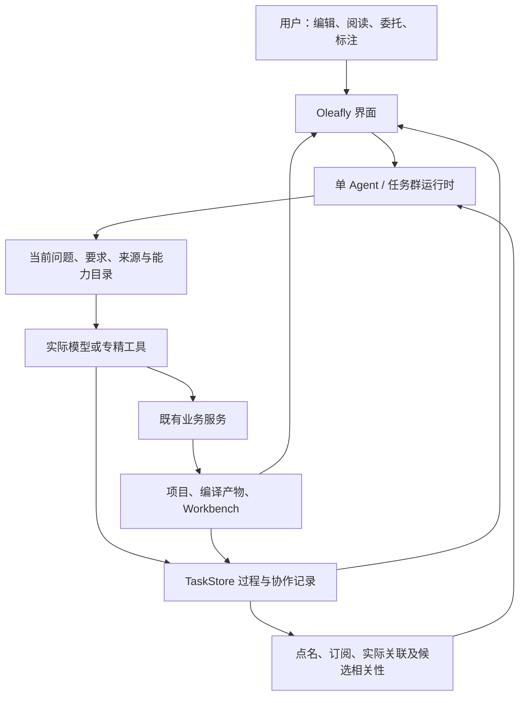

# Oleafly Agent：目标架构与工作合同

核对日期：2026-11-10。适用范围：普通 Agent、ResearchTask、任务群与应用能力接入。
本文维护职责及行为合同；[状态与计划](status.md)区分已实现、已运行和剩余工作，
[复用依据](reuse.md)记录固定版本的设计输入。目标行为不能仅凭本文当作已交付能力。

## 应用与数据所有权

单 Agent 与任务群共用 Oleafly 业务能力。用户继续编辑、编译、阅读、检查和接管；
任务群改变工作组织方式。普通应用 Agent 与 ResearchTask 保留各自执行入口，同一次执行有明确负责人。

| 所有者 | 负责什么 |
| --- | --- |
| 应用服务和工具 host | 编辑、编译、PDF、文献、期刊、项目、实验及界面交接，复用与人工操作相同的业务语义。 |
| 普通 Agent / ResearchTask runtime | 会话、执行、取消、续跑、成员组织及既有 review/apply。 |
| TaskStore | 协作身份、可靠消息、逐成员工作、标注、执行归属和结果关联；可靠业务记录与流式 transcript 分开。 |
| Workbench | 保留源件、基线、规则世界、显式绑定、检查、回执及领域有效性；领域服务不调度 Agent。 |
| Git / SharedDocument / 文件观察 | 既有历史、文本协作和变化发现；文件观察不证明操作者身份。 |
| Provider / MCP / ACP adapter | 实际执行端及工具接入，按其真实能力解释发送、取消、恢复、结果和用量。 |

不强行合库，也不为展示复制第二份领域事实。权限和人工审阅沿既有合同，不增加逐操作审批。
现行字段、存储版本与限制由[实现](../../crates/oleafly-research/src/store/mod.rs)和
[Workbench 合同](../../services/research-workbench/contracts/journals/world-contract.json)负责。

## 成员、工作与恢复

- 持续 member ID 与每次 execution、代次、会话、实际模型、上下文和用量分别归属。
  任务/目标修订与工作依据可追溯；目标修订不改写旧结论，不通过降低标准宣告完成。
- 消息、回复关系、各收件人的工作和触发原因先可靠保存，再通知唤醒。忙碌时输入排队，
  合并一次唤醒不丢失各问题与处理结果。通知只是加速，恢复以持久记录为准。
- 当前同群串行执行一位成员。成员一轮结束可等待；无人执行不等于目标完成。
  局部等待不向请求者伪报完成；原请求保持 waiting，并在该成员下一次有 pending 工作时
  同轮领取。中断重领核对执行代次，保留相同 work/cause；尚未持久化的在途会话可能丢失。
- `group_message` 实际创建同事工作后，当前工具批次完整结束，再让出本轮并保存成员会话；
  未创建工作时明确返回未排队，不进入等待。局部等待与全局暂停、取消、预算停止分开。
  同事最终结束时，将结果自动送回本轮领取的原请求者；普通回复不触发无条件回信。
  仅当前执行已明确发送过完全相同的最终正文时抑制重复，不把先前进度或不同答复当成最终结果。
  waiting 不产生 `member_finished`，嵌套委派恢复后仍保留上游原请求。
- 暂停保留待处理事项；关闭群的普通事件不自动重开。用户在旧对象提出明确请求，可按已有入口接续，
  无需再次表达同一授权。保存普通评价本身不启动模型。
- 成员共享已有任务预算，分别记录用量并汇总；恢复或换目标不重置额度。未知用量保持未知，
  reported usage 不包装成精确账单或外部副作用完成保证。

## 交流、关注与探索

路由累加点名/回复、显式订阅、实际对象关系和依据变化；语义判断只补充候选接收人与理由，
不取消明确投递。关键词只触发核查，引用、否定与反例仍需理解。探索成员可在方法正确时提出并执行新路线。

当前实际关联来自最终成功的内置成员受管读写及标注处理，保留对象版本和调用来源。
失败或输出超限不建立成功关系。helper、shell、MCP 和外部后台写入尚不统一归因，未知作者保持 system。
同一状态重复扫描幂等，但 H2→H3→H2 是新变化；不能用曾读过该 hash 永久压制后续通知。

任务自身记录目录中的 `handoff.md` 和 `plan.md` 是协调记录。这两项的文件变化仍保留事件、版本与
实际读写关系，但不单凭隐式读写关系启动成员，避免记录一次完成又反复唤醒同事。
显式路径、对象或事件订阅，以及消息和明确标注照常投递。其他任务的同名文件、当前任务的
brief、notes、ledger 和研究证据继续采用原有变化路由。

用户明确请求优先进入相关工作，不因所标对象年龄衰减，不抢占无关工作。普通评价不因订阅或历史关系
自动启动一轮模型。旧记录缺少触发理由时标为未记录，不补造历史归因。

## 应用现场与实际产物

任务冻结所委托项目、缓冲、选区、来源版本、编译配置及支持的执行端。当前窗口可以继续变化，
历史证据不能被当前内容替换。任务副本产物与原项目分别识别；编译成功后按任务需要核对实际内容。

PDF 选段保留用户当时看到的原件、hash、页码、矩形、旋转、选文和 checkpoint。
当前评论与引用材料分开；任务原件输入、当前源码、新编译输出各有身份。输入初始化与任务状态提交协调，
未完成输入的任务不能启动或由重试绕过。回滚只撤回本次未使用的初始化内容，不抹掉真实执行或历史讨论。

编译结果回链复用现有 artifact registry。处理工具接收完整编译引用，验证任务、代次及实际字节后
保存规范目标；手工拼造引用不能绕过验证。打开历史产物按其原身份回读，缺失或不符明确不可用。
用户可以从处理结果返回来源或产物，后台执行不任意抢焦点。

`read_paper` 与 `task_pdf_text` 以有界窗口返回实际文本、连续字节游标和精确来源；
PDF 身份、提取文本身份和读取范围分别保留，精确文本使用现有 TaskStore 快照。
页范围由提取时的结构化页面偏移计算，正文中的同形页码文字不作为分页依据。
文献缓存核对 PDF 与文本哈希、保留真实页数；缺失旧元数据时从保留 PDF 重提取。
helper 的文献和任务 PDF 读取同样记录最终 ToolOutcome 与命名空间归属。
DOI 元数据验证仅确认文献身份，不能替代正文对主张的支持核查。

成员取得当前问题、触发原因、适用要求、相关依据和查询入口。共享能力目录，按需加载工具和 Skill，
保留继续发现的入口。实际提供的 schemas、技能、字节与执行可观察；提供、收到、理解和采用分开解释。
默认给摘要和准确回读句柄，避免重复注入完整工作、全套规则和历史讨论。

运行时恢复快照保留完整执行历史；界面首屏只取最近 100 条事件和执行，并按持久游标继续加载。
窗口外的记录仍可按稳定 ID 精确回读，归属校验不通过时明确拒绝。完整记录可回读不等于模型自动获得全部历史，
成员仍通过摘要、触发原因和查询入口按需取证。
跨任务记忆可提供待核对的来源候选，不是第二套事实库；当前要求仍由有出处的项目或领域记录负责。

## 跨时间标注与持续要求

标注可围绕消息、操作、finding、run、引用、正文或决定，不要求每句话先建立 decision。
原话、作者、目标修订、回复、提及和行动结果保留。旧决定已修订时，从旧对象追查当前影响，
不能把旧内容自动当作今天的指令。

| 标注意图 | 处理 |
| --- | --- |
| 明确纠正或约束 | 在适用范围内落实，并核查结果。 |
| 疑问、反例、点名复核 | 查原依据与当前事实，可修改、解释或保留未解决问题。 |
| 遗漏规则建议 | 核对来源、范围和冲突，候选与正式规则身份分开。 |
| 情绪、评价、能力要求 | 原话保留；有工作意图时定位具体表现及可验证改进。 |

用户要求与 Agent 建议保持来源区别；附和不升级为用户要求或事实。“收到”只表示接收。
原始标注提交即可靠保存，活跃池是当前未决问题与有效要求的可重建视图；二次处理结合真实 handling
提炼长期价值。讨论处理完毕不自动撤销持续要求，撤回、修订或范围结束才改变效力。

保存、排队、prepared、实际发送和处理完成分别表达。ACP 仅在完整 `session/prompt` 帧写出并 flush 后
记录 delivered，它不证明远端已理解或完成。发送前失败保留开放请求，不自动循环；发送后取消/断线不撤销
已有回执，未知结果先核对，不盲目重发。旧迁移回执不追认为当时真实发送证据。

`@成员`指持续身份，实际模型按次记录。任意 `@模型`的一轮指定执行仍属目标设计；不可用不能静默换模型。
能力反馈应区分未找到来源、未提供上下文、工具失败、规则遗漏与判断错误，再改有依据的一处配置并核对效果。
只输出分数或结构化判断的小专精可以是工具，无需包装成会聊天的成员。

## 文件、领域有效性与跨库接续

受管任务群文件操作在已有写入锁下比较读取版本，冲突要求重读。shell/MCP/外部写入未统一覆盖。
未来并行或外部执行端按需要使用独立副本和补丁汇合；应用原项目仍走既有 apply、journal 与回滚入口。
精确读取快照按任务/代次/路径/hash 留存；模型实际收到的结果以最终 ToolOutcome 为准，留存成功不等于收到。

Finding 的原判定、来源、依赖、方法版本、处置和当前有效性分开。TaskStore 统一定位和后续工作，
各领域解释自身 validity。假设不自动变成正式 finding，未同步状态不能显示为当前通过。

Workbench 与 TaskStore 各自提交。补接按任务绑定的库/稿件重扫已枚举的 world、rule、binding、check
和 disposition；TaskStore 同事务保存回执、投影、事件与逐成员 work。轮询和操作后补扫补回停机期间变化，
重复记录去重；不声称跨库原子快照或全领域事件日志。

已知检查提交者先持久关联再补扫，避免同步失败后唤醒自己。检查 POST 已提交但返回/落盘未知时先查询历史，
不能为补日志重新 POST。外部混合变化继续正常通知。

新 W2 可用而稿件仍绑定 W1、输入与方法依赖未变时，旧检查可保持 CURRENT 并提示 update_available。
不自动重绑或将全部旧检查标 stale。DOCX 与 LaTeX 是不同对象，关联或转换不证明两者检查结论等价。

以上合同使用已有业务服务、TaskStore、文件隔离及 review/apply；[组件依据](reuse.md)不构成安装第二套运行时的要求。
